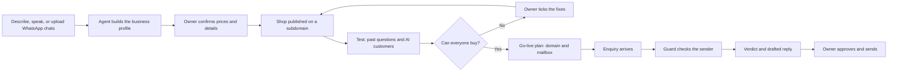
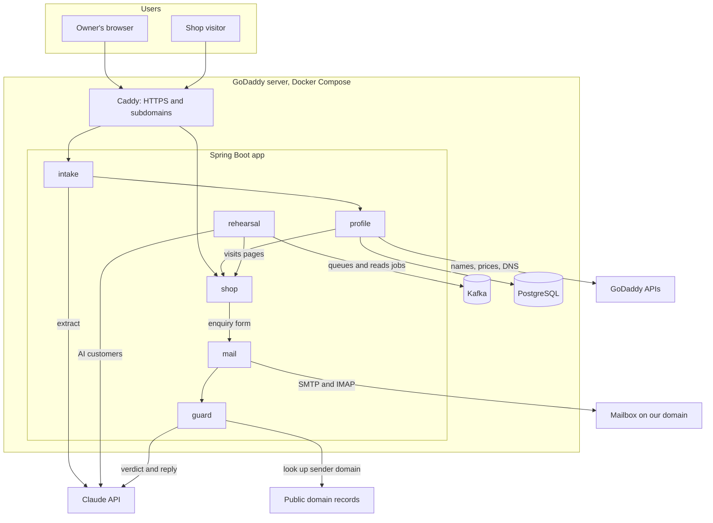
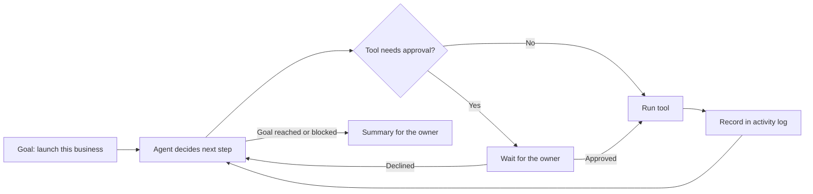
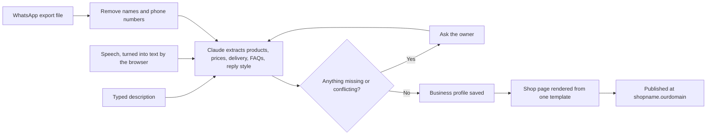
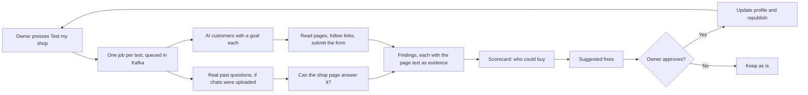
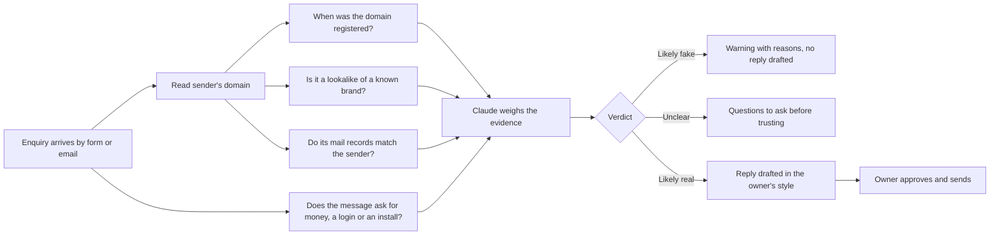
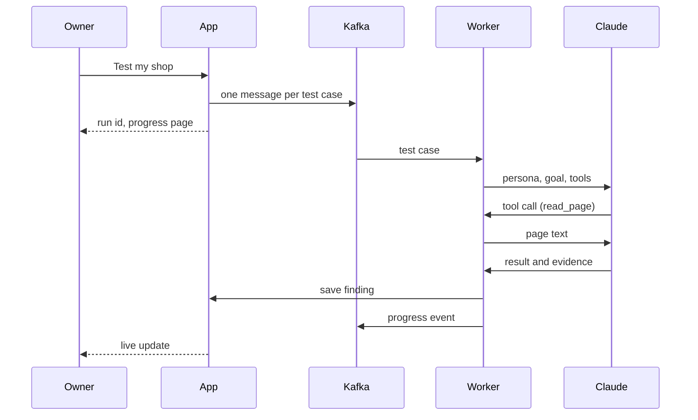
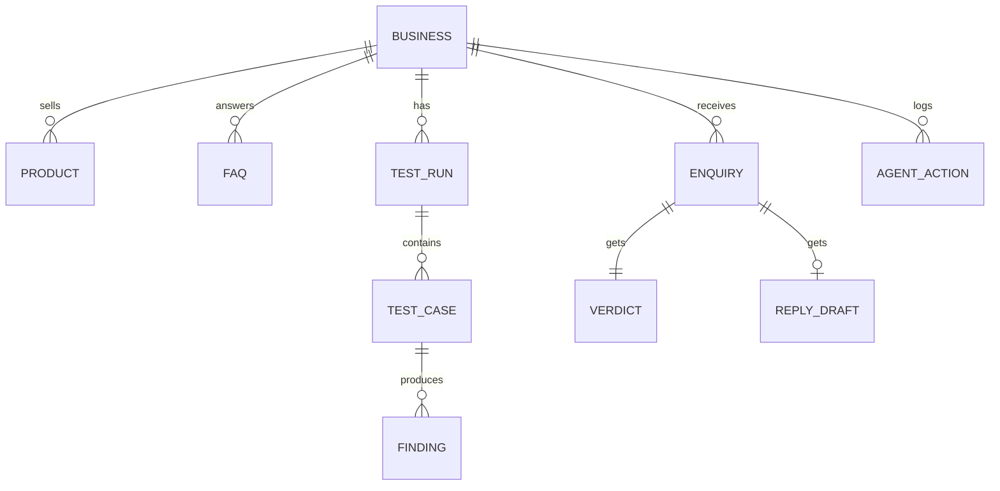
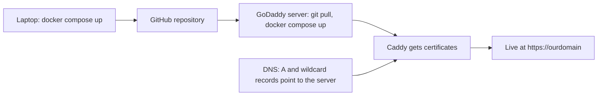

# BazaarReady — Design Document

GoDaddy Inclusive Innovation Hackathon 2026, Round 2. Build phase 13–20 November 2026.

Status: design agreed on 14 Nov 2026. No feature code written yet.

## 1. What it is

BazaarReady is a launch agent for solo sellers and creators. It takes a business from a description or its WhatsApp history to a live shop, proves that customers can actually buy, and guards the inbox against fake enquiries. The owner approves; the agent does the work.

It is explained in three verbs:

| Stage | What happens |
|---|---|
| **Build** | The owner describes the business by typing or speaking, or uploads a WhatsApp chat export. The agent turns it into a shop page. |
| **Test** | Real past customer questions and AI customers try to buy. The agent fixes what stopped them and tests again. |
| **Protect** | Every enquiry that arrives is checked: is this brand deal or bulk order real or fake? Real ones get a drafted reply. |

**Who it is for:** home sellers who run their business on WhatsApp, and small creators and freelancers who receive brand-deal and work enquiries by email.

**Challenge statement it answers:** "Build agentic business solutions leveraging Claude and GoDaddy technologies to help entrepreneurs, creators, and small businesses go from idea to launch."

## 2. Features

`Must` is what we submit. `Should` goes in only if every Must works by 18 Nov. `Later` is named in the project brief as future work.

| # | Stage | Feature | What the owner sees | Priority |
|---|---|---|---|---|
| F1 | Build | Build from a description | Types or speaks in Hindi or Hinglish; answers 2–3 questions | Must |
| F2 | Build | Build from a WhatsApp export | Uploads the chat file; sees "what I learned" (prices, delivery, top questions) | Must |
| F3 | Build | Private details removed | Customer names and numbers never stored or shown | Must |
| F4 | Build | Shop page published | Live link with price list, FAQ, WhatsApp button, enquiry form | Must |
| F5 | Test | Replay of real past questions | "44 of 50 past questions are answered by your shop" | Must |
| F6 | Test | AI customers | Three customers try to buy; report with evidence of where each got stuck | Must |
| F7 | Test | Fix and retest | Ticks fixes; score before and after | Must |
| F8 | Protect | Fake-or-real check | "Likely fake: domain registered 9 days ago", with reasons | Must |
| F9 | Protect | Drafted reply | Reply in the owner's style, sent after one tap | Must |
| F10 | Build | Go-live plan | Suggested domain with live GoDaddy price; nothing bought without approval | Should |
| F11 | Build | Photos of a rate card | Uploads a photo instead of typing prices | Should |
| F12 | Test | Live progress view | Watches each customer's steps as they happen | Should |
| F13 | Test | AI-assistant customer | Checks a shopping assistant can read the shop | Later |
| F14 | Protect | Verified agent identity | Shop's agent registered with GoDaddy Agent Name Service | Later |
| F15 | All | Agent activity log | A running list of what the agent did and what it is waiting for | Must |

## 3. Owner's journey



The owner makes three kinds of decision only: confirm the details, tick the fixes, approve the reply.

## 4. Tech stack

| Layer | Choice | Why |
|---|---|---|
| Language | Java 17 | Already installed (IntelliJ JDK); interview-relevant |
| Framework | Spring Boot 3.5 (Web, Validation, Data JPA, Mail, Actuator) | Standard backend stack |
| Owner screens | React 18, TypeScript, Vite; built into the Spring Boot jar and served from it | The interactive screens judges watch: live test progress, agent activity log, approvals, inbox |
| Public shop pages | Thymeleaf templates, plain CSS | Plain server-rendered HTML, which the AI customers read and the accessibility checks inspect |
| Database | PostgreSQL 16 | Relational data with JSON columns where useful |
| Migrations | Flyway | Schema is versioned in the repo |
| Async jobs | Kafka (single node, KRaft mode) | Each test is a job; progress events stream to the screen |
| AI | Claude API through Anthropic's official Java SDK (`com.anthropic:anthropic-java`; exact version to confirm on Maven Central) | Tool use for the agents |
| Speech | Browser Web Speech API (`hi-IN`, `en-IN`) | Free; turns speech into text before it reaches the server |
| Email out | SMTP through Spring Mail | Hackathon guide suggests `smtpout.secureserver.net` |
| Email in | IMAP polling (Jakarta Mail) | To be verified on the Titan Pro Light plan |
| Domain checks | RDAP for registration date; DNS lookups (`dnsjava`) for MX, SPF, DMARC | Public records, no paid API |
| GoDaddy | GoDaddy REST API for domain suggestions and prices, DNS records, mailbox | Called from a small Java client |
| HTTPS and routing | Caddy in front of the app | Automatic certificates; routes `*.ourdomain` to the app |
| Packaging | Docker, Docker Compose | Same setup on laptop and on the GoDaddy server |
| Tests | JUnit 5, Testcontainers (PostgreSQL, Kafka) | Real dependencies in tests |

Not used: Spark (no large dataset to justify it).

## 5. Architecture



### Code layout

One Spring Boot application, split into packages by feature:

```
com.bazaarready
├── agent       the launch agent loop, tool registry, approval gates, activity log
├── intake      description and speech input, WhatsApp parser, PII redaction
├── profile     business, products, FAQs; the single source the shop is built from
├── shop        public shop pages, subdomain routing, enquiry form
├── rehearsal   test runs, Kafka producer/consumer, AI customers, findings, fixes
├── guard       sender checks, verdict, reply drafts
├── mail        SMTP sending, IMAP polling
├── claude      Claude client, prompts, tool definitions, model choice
├── godaddy     GoDaddy API client
└── common      config, error handling, security

frontend/       React app for the owner's screens (Vite, TypeScript)
```

The React app is built during the Docker build and copied into the jar's static files, so there is still one application to deploy. The public shop pages stay in Thymeleaf.

### The launch agent

The challenge asks for an agentic solution. So the app does not call Claude step by step in a fixed order. Claude is given a goal ("get this business launched") and a set of tools, and decides the steps itself. Our code runs the tools, enforces the approval gates and records every action.



| Tool | What it does | Needs the owner's approval |
|---|---|---|
| `ask_owner` | Asks a question when details are missing or conflict | No (it is the question) |
| `save_profile` | Saves products, prices, delivery, FAQs | No |
| `search_domains` | GoDaddy name suggestions and availability | No |
| `get_domain_price` | Live GoDaddy price for a name | No |
| `publish_shop` | Publishes the shop on its subdomain | Yes |
| `run_tests` | Starts a test run | No |
| `propose_fix` / `apply_fix` | Suggests a change; applies it | Yes, to apply |
| `lookup_domain_age` | Registration date of a sender's domain (RDAP) | No |
| `lookup_mail_records` | MX, SPF and DMARC records of a sender's domain | No |
| `fetch_official_site` | Reads a brand's real site to compare domains | No |
| `draft_reply` | Drafts a reply in the owner's style | No |
| `send_reply` | Sends the reply | Yes |
| `prepare_go_live` | Builds the domain, DNS and mailbox plan with prices | Stops here; nothing is bought |

Limits: a maximum number of steps per run, a timeout per tool, and no tool that spends money. The activity log (F15) shows each step in plain language, for example "Checked 5 names → bazaarcakes.com is free → published shop → ran 53 tests → 9 failed → proposed 3 fixes → waiting for your approval".

## 6. Flows

### 6.1 Build



All inputs produce the same business profile, so everything after this point is shared.

WhatsApp import details:
- Parse lines of the form `date, time - sender: message` (two formats tested at minimum: Android and iPhone).
- Redact before anything is sent to Claude or stored: phone numbers by pattern, customer names replaced with `Customer N`. The owner's own name is kept as the seller.
- Long chats are split into chunks; each chunk is extracted separately, then merged, with conflicts (two prices for one item) raised as questions to the owner.
- The uploaded file is deleted after extraction.

### 6.2 Test



AI customers (first three):

| Customer | Goal | What it exposes |
|---|---|---|
| Meena, 62, reads Hindi | Order a birthday cake | Missing Hindi text, unclear wording |
| Rahul, 28, in a hurry on his phone | Find a price in under a minute | Prices hidden in images, long pages |
| Farah, 35, uses a screen reader | Find eggless options | Missing image descriptions, unlabelled form fields |

Each AI customer is Claude with three tools: `read_page(url)`, `follow_link(text)`, `submit_enquiry(fields)`. It only knows what the tools return. Accessibility findings are confirmed by plain code checks (missing `alt`, unlabelled inputs, low contrast) so they do not rest on the model's opinion alone.

A fix is a change to the business profile, never a hand edit to a page, so the retest runs against a cleanly rebuilt shop.

### 6.3 Protect



Rules:
- The checks are tools. The agent chooses which to call for each enquiry; their results are facts produced by code, and Claude weighs and explains them.
- The verdict always says "likely" and lists its evidence. It never says "safe".
- No reply is ever sent without the owner's approval.
- Free mail addresses (gmail.com and similar) skip the domain checks and are judged on message content, marked "cannot verify sender".

### 6.4 Test run, step by step



## 7. Database



| Table | Main columns |
|---|---|
| `business` | `id`, `name`, `slug` (subdomain), `owner_language`, `whatsapp_number`, `delivery_notes`, `notice_days`, `reply_style` (text learned from chats), `source` (DESCRIPTION, WHATSAPP, PHOTO), `published_at`, `created_at` |
| `product` | `id`, `business_id`, `name`, `price_paise`, `unit`, `variants` (JSON), `min_quantity`, `sort_order` |
| `faq` | `id`, `business_id`, `question`, `answer`, `times_asked`, `source` (CHAT, OWNER, FIX) |
| `test_run` | `id`, `business_id`, `status` (QUEUED, RUNNING, DONE, FAILED), `total_cases`, `passed_cases`, `started_at`, `finished_at` |
| `test_case` | `id`, `test_run_id`, `kind` (PAST_QUESTION, AI_CUSTOMER), `persona`, `goal_or_question`, `status`, `passed` |
| `finding` | `id`, `test_case_id`, `problem`, `evidence` (page text seen), `suggested_fix` (JSON change to the profile), `fix_status` (PROPOSED, APPROVED, REJECTED, APPLIED) |
| `enquiry` | `id`, `business_id`, `channel` (FORM, EMAIL), `sender_name`, `sender_email`, `sender_domain`, `subject`, `body`, `received_at` |
| `verdict` | `id`, `enquiry_id`, `label` (LIKELY_FAKE, UNCLEAR, LIKELY_REAL), `checks` (JSON: each check and its result), `explanation`, `created_at` |
| `reply_draft` | `id`, `enquiry_id`, `body`, `status` (DRAFT, APPROVED, SENT), `sent_at` |
| `agent_action` | `id`, `business_id`, `run_id`, `step_no`, `tool`, `input` (JSON), `result_summary`, `status` (DONE, WAITING_APPROVAL, APPROVED, DECLINED, FAILED), `created_at` |

Money is stored in paise as integers. Uploaded chat files are not stored.

## 8. HTTP endpoints

Owner side (served on the main domain):

| Method and path | Purpose |
|---|---|
| `POST /api/businesses` | Start from a description (text; speech arrives as text) |
| `POST /api/businesses/import/whatsapp` | Upload a chat export |
| `GET /api/businesses/{id}/profile` | "What I learned" screen, with open questions |
| `PUT /api/businesses/{id}/profile` | Owner's answers and corrections |
| `POST /api/businesses/{id}/publish` | Publish the shop |
| `POST /api/businesses/{id}/test-runs` | Start a test |
| `GET /api/test-runs/{id}` | Scorecard and findings |
| `GET /api/test-runs/{id}/events` | Live progress (server-sent events) |
| `POST /api/findings/{id}/approve` | Approve a fix |
| `GET /api/businesses/{id}/enquiries` | Inbox with verdicts |
| `POST /api/reply-drafts/{id}/send` | Approve and send a reply |
| `GET /api/businesses/{id}/go-live-plan` | Domain suggestions and prices (F10) |
| `GET /api/businesses/{id}/activity` | The agent's activity log (F15) |
| `POST /api/agent-actions/{id}/approve` and `/decline` | The owner's answer at an approval gate |

Public side (served on `{slug}.ourdomain`):

| Method and path | Purpose |
|---|---|
| `GET /` | The shop page |
| `POST /enquiry` | The enquiry form |

The app's own contact form (a hackathon requirement) lives at `/contact` on the main domain and sends to our mailbox.

## 9. Kafka topics

| Topic | Message | Produced by | Consumed by |
|---|---|---|---|
| `test-cases` | One test case to run | Test run service | Test workers |
| `test-progress` | Step and result events | Test workers | Progress stream to the browser |
| `enquiries` | A new enquiry to check | Mail and form handlers | Guard |

Built first with Spring's in-process async, then switched to Kafka once the flow works. Failed test cases are retried once, then marked FAILED so a run always finishes.

## 10. How Claude is used

| Task | Model | Notes |
|---|---|---|
| The launch agent (tool use, decides the steps) | `claude-sonnet-5-5` | Step limit per run; approval gates enforced in code |
| Extracting the profile from chat chunks | `claude-haiku-5-5` | High volume, simple; JSON output |
| Merging chunks, raising conflicts | `claude-sonnet-5-5` | |
| Follow-up questions in Hindi or Hinglish | `claude-sonnet-5-5` | |
| Shop text and FAQ | `claude-sonnet-5-5` | |
| AI customers (tool use) | `claude-sonnet-5-5` | Three tools; step limit per customer |
| Checking a past question against the shop | `claude-haiku-5-5` | |
| Weighing the fake-or-real evidence | `claude-sonnet-5-5` | The agent calls the lookup tools it needs |
| Drafting replies in the owner's voice | `claude-sonnet-5-5` | Reply style is cached |

Practices from the kickoff deck: structured JSON output, `max_tokens` set on every call, prompt caching for repeated system prompts and the business profile, a saved set of 10 real cases rerun after each prompt change, and the owner confirming before anything is sent or spent.

## 11. How GoDaddy is used

| Use | Where |
|---|---|
| Server (4 vCPU / 8 GB) | Runs the whole app in Docker |
| Our domain, HTTPS | The live link |
| DNS records | Wildcard record for shop subdomains; MX and mail records for the mailbox |
| Mailbox (Titan Pro Light, 1 month) | Receives enquiries and our contact form |
| Domain suggestions and live prices | Go-live plan (F10) |
| Website security scan | Pre-launch check, if time allows |
| Agent Name Service | Later (F14); not yet verified on this account |

## 12. Security and privacy

- Secrets (Claude key, mailbox password, GoDaddy token, database password) live only in `.env`, which is in `.gitignore`. A `.env.example` lists the names without values.
- Chat exports are redacted before any model call and deleted after extraction.
- Everything shown on a shop page is escaped; uploads are limited by size and type.
- Text from chats, shop pages and emails is treated as data, never as instructions to the model.
- Rate limits on the public enquiry form; a hidden field to catch bots.
- No payment handling. The go-live plan stops at the owner's approval and buys nothing.

## 13. Deployment



Compose services: `caddy`, `app`, `db`, `kafka`.

Environment variables: `DB_NAME`, `DB_USER`, `DB_PASSWORD`, `ANTHROPIC_API_KEY`, `GODADDY_TOKEN`, `MAIL_HOST`, `MAIL_USER`, `MAIL_PASSWORD`, `APP_DOMAIN`.

## 14. Build plan

| Day | Goal | Done when |
|---|---|---|
| 15 Nov | Skeleton (Spring Boot, React shell), business profile, agent loop with the first tools, build from a description | A typed description becomes a shop page on the laptop, with the steps shown in the activity log |
| 16 Nov | WhatsApp import with redaction; speech input | A sample chat file becomes a shop with its real prices and FAQ |
| 17 Nov | Test runner: past questions, three AI customers, fix and retest | The score rises after a fix |
| 18 Nov | Enquiry form, mailbox, fake-or-real check, drafted reply | One fake and one real email get the right verdicts |
| 19 Nov | Deploy to the GoDaddy server: domain, HTTPS, mailbox; Should items | The live link works end to end |
| 20 Nov | Project brief, demo script, final checks, submit | Submitted on HackerEarth |

Submission time on 20 Nov has not been announced, so 19 Nov is treated as the last full build day.

## 15. Demo script (3 minutes)

1. Upload a sample WhatsApp chat. The "what I learned" screen appears and asks which of two prices is current.
2. Publish. The shop opens on its subdomain.
3. Press Test. Score: 44 of 50 past questions, 1 of 3 AI customers.
4. Tick two fixes. Retest: 50 of 50, 3 of 3.
5. Two emails arrive. One gets "Likely fake" with reasons. The other gets a drafted reply, approved with one tap.

## 16. Open points

| Point | Status |
|---|---|
| GoDaddy server not yet in the cart | Ticket 51149491503 open with HackerEarth support since 14 Nov; app runs on the laptop until then |
| IMAP access on Titan Pro Light | Not verified; fallback is enquiries by form only |
| Anthropic Java SDK version | Confirm on Maven Central on 15 Nov |
| Rules on AI coding assistance | Ask at office hours; disclosed in the README either way |
| Domain name for the app | `bazaarready.com`, shown as available by GoDaddy on 15 Nov; price to confirm before buying (similar `.com` names were $9.19 for the first year) |
| Project folder and starter files | Still named `pehla-grahak` / `com.pehlagrahak`; to be renamed when building starts |
| Submission time on 20 Nov | Not announced |

## 17. Built with

Claude Code was used as an assistant for both the design and the code.
